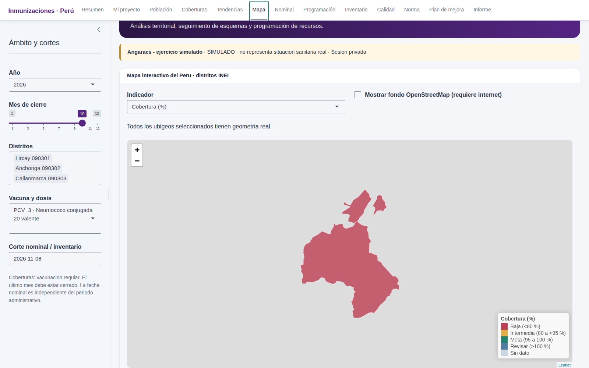

# Sala situacional de inmunizaciones del Perú

[](https://github.com/f-slg/sala-inmunizaciones-peru/actions/workflows/R-CMD-check.yaml)
[](LICENSE.md)

Aplicación educativa **R/Shiny + golem** para que cada estudiante construya,
interprete y mantenga su propia sala situacional de inmunizaciones. Incluye
población objetivo, coberturas, continuidad, seguimiento nominal, mapas reales,
necesidad de dosis, inventario, insumos, cadena de frío y planes de mejora.

**Versión inicial 0.2.0.** El catálogo incluye 33 productos y 116 reglas; 34
reglas tienen evaluación nominal educativa automatizada. Los casos especiales,
transiciones y lineamientos específicos requieren revisión documentada. Todos
los datos publicados de demostración son **simulados**, aunque los distritos y
sus límites geográficos son reales. Este es un proyecto independiente; no es un
producto oficial del MINSA ni una certificación clínica.



## Contenido

- [Qué permite hacer](#qué-permite-hacer)
- [Instalar y ejecutar paso a paso](#instalar-y-ejecutar-paso-a-paso)
- [Elegir cualquier ámbito incluido en la cartografía](#elegir-su-territorio)
- [Diccionario y listas desplegables](#diccionario-y-listas-desplegables)
- [Primer ejercicio de 10 minutos](#primer-ejercicio-de-10-minutos)
- [Usar su propia población y datos](#usar-su-propia-población-y-datos)
- [Guardar el trabajo individual](#guardar-el-trabajo-individual)
- [Instalar como paquete](#instalar-como-paquete)
- [Alcance normativo](#alcance-normativo-explícito)
- [Contrato de datos](#contrato-de-datos)
- [Cálculos y supuestos](#cálculos-y-supuestos)
- [Mapas reales](#mapas-reales)
- [Problemas frecuentes](#problemas-frecuentes)
- [Pruebas y contribuciones](#verificación)

## Qué permite hacer

| Necesidad | Producto de la aplicación |
|---|---|
| Definir el ámbito | Proyecto individual con ubigeos INEI, fuentes y fechas de corte. |
| Revisar población | Denominadores por edad/grupo, año y territorio, con fuente y versión. |
| Analizar desempeño | Coberturas, brechas, tendencias y deserción administrativa. |
| Revisar el registro nominal | Dosis específicas exigibles, secuencia, corte y casos que necesitan revisión. |
| Identificar brechas territoriales | Mapa interactivo con polígonos reales de `mapsPERU` y controles `leaflet`. |
| Programar recursos | Dosis a administrar, pérdidas, existencias, tránsito, reserva, frascos e insumos. |
| Revisar abastecimiento | Balance por lote, vencimientos, cuarentena, FEFO y riesgo de quiebre. |
| Preparar decisiones | Plan de mejora con evidencia, responsables, fechas y metas. |
| Entregar un trabajo reproducible | Libro privado del proyecto, resultados agregados e informe HTML. |

La aplicación corre en el equipo o servidor donde se inicia R. **Publicar el
código en GitHub no publica automáticamente una aplicación web.** Un fork del
repositorio tampoco debe contener los datos reales del estudiante.

## Instalar y ejecutar paso a paso

### 1. Instalar R y RStudio

Instale **R 4.2 o superior** desde [CRAN](https://cran.r-project.org/) y después
[RStudio Desktop](https://posit.co/download/rstudio-desktop/).

- **Windows:** use los instaladores correspondientes a su sistema. Prefiera
  paquetes binarios cuando R ofrezca esa opción.
- **macOS:** elija R para Apple Silicon o Intel según su equipo. Prefiera
  binarios; compilar paquetes puede requerir herramientas adicionales.
- **Linux:** además de R, la compilación de `sf` puede necesitar GDAL, GEOS,
  PROJ y UDUNITS2. Ejemplo para Ubuntu/Debian:

```bash
sudo apt install r-base build-essential libgdal-dev libgeos-dev libproj-dev \
  libudunits2-dev libcurl4-openssl-dev libssl-dev libxml2-dev
```

Ese comando es específico de Ubuntu/Debian; no se ejecuta en Windows ni macOS.
La aplicación no usa comandos del sistema para sus cálculos.

### 2. Obtener una copia propia

Para comenzar sin Git:

1. Abra [el repositorio](https://github.com/f-slg/sala-inmunizaciones-peru).
2. Pulse **Code → Download ZIP**.
3. Descomprima el ZIP en una carpeta permanente de su equipo.
4. Abra `salainmunizaciones.Rproj` con RStudio.

Si desea conservar sus cambios de código en GitHub, use **Fork** primero y
clone su copia. Para el repositorio de referencia:

```bash
git clone https://github.com/f-slg/sala-inmunizaciones-peru.git
cd sala-inmunizaciones-peru
```

Mantenga sus datos reales en `datos_privados/`, `proyectos_alumnos/` o fuera del
repositorio. Las carpetas privadas y los libros no autorizados están excluidos
por `.gitignore`; revise siempre los archivos antes de un commit.

### 3. Instalar las dependencias

En la consola de RStudio, con el proyecto abierto:

```r
source("instalar.R")
```

Espere a que finalice. El script comprueba las dependencias y se detiene si alguna
no queda disponible. Se necesita conexión a CRAN la primera vez. La aplicación
no necesita Excel, Java, Python ni Node.js para funcionar. Los scripts Python de
`dev/` solo sirven para regenerar dos libros distribuidos ya preparados.

### 4. Ejecutar la sala

Abra `app.R` y pulse **Run App**, o ejecute:

```r
shiny::runApp()
```

Para detener la aplicación, pulse **Stop** en RStudio. `app.R` carga el código
de la copia abierta, aunque haya otra versión del paquete instalada.

### Alternativa: Posit Cloud

1. Cree un proyecto RStudio en [Posit Cloud](https://posit.cloud/).
2. Suba el ZIP del repositorio y descomprímalo.
3. Abra la carpeta que contiene `DESCRIPTION`, `app.R` y `instalar.R`.
4. Ejecute `source("instalar.R")` y luego `shiny::runApp()`.

Si el ZIP creó una subcarpeta, entre en ella antes de ejecutar los comandos.
En Posit Cloud los archivos se procesan en su proyecto en la nube: no es una
sesión que se ejecute exclusivamente en su computadora.

## Elegir su territorio

La demostración inicial contiene tres distritos, pero **no limita la sala a esos
lugares**. En **Mi proyecto → Seleccione su territorio en el Perú**:

1. Seleccione departamento y provincia.
2. Busque uno o varios distritos por nombre; los códigos mostrados son ubigeos INEI.
3. Pulse **Agregar a mi selección**. Puede repetirlo con otras provincias o departamentos.
4. Revise la lista y el mapa de contexto nacional. Los marcadores identifican los
   distritos elegidos; la vista previa no contiene indicadores de salud.
5. Descargue **Plantilla integral de mi territorio** o **Población de mi territorio**.
   La hoja `territorios` ya contiene códigos y nombres; población y vacunación
   permanecen vacías para ingresar sus fuentes propias.
6. Complete las hojas necesarias y cargue el libro integral. Los filtros y el
   mapa de indicadores usarán los territorios de ese archivo.

El directorio tiene 1.891 distritos de `mapsPERU` 2.0.1, con representación de los
24 departamentos y la Provincia Constitucional del Callao. No es un registro INEI actualizado en línea. Si un distrito
nuevo no aparece, conserve su ubigeo INEI real en la plantilla; la lista de ubigeo
muestra una advertencia que permite conservar el código verificado. El mapa
avisará si no dispone de su geometría; nunca lo ubicará sobre otro distrito.

## Diccionario y listas desplegables

[Diccionario_variables.xlsx](entregables/Diccionario_variables.xlsx) documenta
**96 campos por hoja**: definición, tipo, unidad, obligatoriedad, ejemplos y
valores permitidos. La misma información está dentro de cada plantilla, en la
hoja `diccionario`, y en **Norma** dentro de la aplicación.

Las plantillas integral y de población contienen catálogos consultables y
validaciones hasta la fila 5001 (o hasta la última fila si un libro ya contiene
más registros):

| Entrada | Ayuda disponible |
|---|---|
| Ubigeo | Lista nacional de códigos y catálogo con distrito, provincia y departamento. |
| Grupo poblacional | `grupo_id` y definición del grupo. |
| Vacuna/dosis/grupo | `regla_id`, con ficha y estado de revisión en `cat_reglas`. |
| Producto físico | `producto_id`, separado de la dosis y de los antígenos. |
| Dosis | `dosis_id`; comprobar también su correspondencia con producto y regla. |
| Sexo y ruta | F/M/X/ND; penta_ipv/hexavalente/revision. |
| Estrategia y reporte | regular/recuperacion/campana/bloqueo; completo/pendiente. |
| Inventario y consumo | TRUE/FALSE para cuarentena y reporte completo. |
| Movimiento | entrada/salida/aplicacion/perdida/ajustes. |
| Conteos y proporciones | Controles numéricos; meta y pérdida 0–1, avance del plan 0–100. |

Son listas estándar de Excel con rangos nombrados, sin macros ni fórmulas
volátiles, compatibles con lectores que admiten validación OOXML. Los códigos
se conservan como texto para proteger ceros iniciales. Copiar y pegar puede
eludir validaciones de una hoja de cálculo: **la validación de R sigue siendo
obligatoria** y los catálogos editados en Excel no modifican las reglas del paquete.
La calculadora de necesidades se conserva como un recurso independiente; no es
la plantilla de carga y sus fórmulas no se reemplazan por valores.

## Primer ejercicio de 10 minutos

1. Abra la aplicación con los datos de demostración.
2. Seleccione **2026**, cierre **octubre**, distrito **Lircay** y regla **PCV_3**.
3. Compruebe la cobertura: **90 dosis / 120 personas de un año × 100 = 75,0 %**.
4. Seleccione los tres distritos: el agregado es **170 / 270 = 62,96 %**.
   Compruebe por qué no es el promedio simple de los porcentajes distritales.
5. Abra **Mapa**, desplace y amplíe la vista y pulse un distrito.
6. Cambie el cierre a noviembre: los reportes pendientes deben quedar ausentes,
   sin convertirse en cero.
7. Abra **Programación** y distinga dosis a administrar, dosis brutas y pedido neto.
8. Revise **Norma** y localice la fuente, la página y el estado de una regla.

Todos esos valores son simulados y no describen la situación sanitaria real de
Lircay, Anchonga ni Callanmarca.

## Usar su propia población y datos

1. En **Mi proyecto**, descargue **Plantilla vacía** o prepare una plantilla de su territorio con el selector nacional. También está disponible
   [Plantilla_integral.xlsx](entregables/Plantilla_integral.xlsx).
2. Complete `configuracion`: alumno, ámbito, año, fecha de corte, fuente y versión.
3. Complete `territorios`: ubigeo INEI de seis dígitos, distrito, provincia y departamento.
4. Complete `poblacion`: una fila por año, ubigeo y `grupo_id`. Consulte `cat_grupos`.
   Puede comenzar con [Plantilla_poblacion.xlsx](entregables/Plantilla_poblacion.xlsx)
   y copiar sus hojas al libro integral.
5. Complete `vacunacion`: una fila por mes, regla, territorio y estrategia.
   Consulte `cat_reglas`. Use `estado_reporte = completo` con conteo cero si hubo
   reporte sin aplicaciones; use `pendiente` con dosis vacías si falta el reporte.
6. Si dispone de información nominal autorizada, complete `personas` y `eventos`.
   No ingrese nombres, DNI, teléfonos ni direcciones. Un identificador seudonimizado
   sigue requiriendo protección y no equivale a anonimización.
7. Para programar dosis, complete `programacion` y `presentaciones`. Documente la
   presentación real y el volumen **empacado** por dosis. Complete inventario y
   movimientos si desea descontar existencias.
8. Guarde el libro XLSX, cárguelo y lea el informe de validación. Los errores
   bloquean la carga completa; los datos anteriores permanecen activos.
9. Ajuste los filtros y compruebe al menos un cálculo manual antes de interpretar.

Los ejemplos están en una hoja separada y no se importan como registros.
La [demostración completa](entregables/Demostracion_integral.xlsx) permite estudiar
la estructura. La [calculadora de necesidades](entregables/Calculadora_necesidades.xlsx)
contiene fórmulas editables y casos aritméticos de comprobación.

**Ejemplo de población** — ilustrativo, no una estimación oficial:

| anio | ubigeo | grupo_id | poblacion | fuente | version |
|---|---|---|---|---|---|
| 2026 | 090301 | A1 | 120 | SIMULADO | ejercicio-2026 |

Use texto para ubigeos e identificadores. Los grupos especiales pueden
superponerse: no sume gestantes, VIH y comorbilidad para obtener personas únicas.
La edad del grupo y la dosis determinan qué denominador corresponde.

## Guardar el trabajo individual

1. Complete su identificación en **Mi proyecto**.
2. Pulse **Guardar proyecto privado (incluye nominal)** y guarde el libro en una
   ubicación privada. Ese libro permite reabrir el trabajo en otra sesión.
3. En **Informe**, descargue los resultados agregados y el informe HTML.
4. Registre una acción con evidencia, responsable, fecha e indicador en **Plan de mejora**.
5. Entregue únicamente los productos autorizados por el docente. El libro privado
   no debe acompañar automáticamente al repositorio o informe público.

No hay guardado persistente automático de sesiones: cerrar R sin descargar el
proyecto puede perder los cambios realizados en la aplicación.

## Instalar como paquete

Esta opción instala la aplicación en una biblioteca de R. Para modificar el código
y seguir la práctica del curso, prefiera el proyecto descargado.

```r
install.packages("remotes")
remotes::install_github("f-slg/sala-inmunizaciones-peru", dependencies = TRUE)
salainmunizaciones::run_app()
```

También puede instalar una copia local desde una terminal:

```text
R CMD INSTALL .
```

Uso de la API pública:

```r
salainmunizaciones::write_template("Mi_plantilla.xlsx")
resultado <- salainmunizaciones::import_workbook("datos_privados/Mi_proyecto.xlsx")
stopifnot(resultado$exito)
salainmunizaciones::run_app(data = resultado$datos)
```

Para una aplicación de consulta agregada use `run_app(public_mode = TRUE, data = datos)`.
Ese modo elimina las tablas nominales del estado de sesión y deshabilita carga
y guardado privado. **No proporciona autenticación** y no comprueba por sí solo
que una agregación evite la reidentificación. Revise los datos que publicará.

## Alcance normativo explícito

Base consultada el **8 de noviembre de 2026**: NTS 246-MINSA/DGIESP-2026,
aprobada por RM 561-2026/MINSA. El catálogo contiene **33 productos** y **116
reglas**, incluyendo todas las familias del cuadro 6.1, antecedentes de productos
y las otras vacunas que requieren lineamientos específicos.

- **34 reglas verificadas**: transcripción de referencia con fuente y página;
  permiten evaluación educativa automatizada dentro de sus condiciones.
- **Condicional**: incorporación progresiva o transición de producto; no se
  certifica cumplimiento automáticamente.
- **Revisión clínica**: gestación, VIH, condiciones especiales, brotes y otras
  vacunas con normativa propia. Se admiten datos agregados y programación
  documentada; la elegibilidad clínica NO se infiere a partir de la edad.

La revisión por OCR de los anexos fue complementada con inspección visual del
cuadro del esquema infantil. La transcripción no es una aprobación del MINSA ni
una certificación clínica. No se afirma haber descartado todas las modificaciones
posteriores a la norma consultada. Antes de usar datos reales, el responsable
académico/sanitario debe revisar fuentes, vigencia, reglas, parámetros y alcance.

La tolerancia de oportunidad de **30 días** es un parámetro pedagógico visible en
el catálogo, no un umbral normativo universal. Las fechas sin hora no certifican
la aplicación de una dosis dentro de 12 o 24 horas del nacimiento.

COVID-19, mpox, dengue y antirrábica humana aparecen con su condición de
**lineamiento específico**. No se inventan esquemas universales para ellas.
Nirsevimab es un anticuerpo monoclonal y se mantiene diferenciado de las vacunas.
La hexavalente y la ruta pentavalente + IPV son alternativas: el sistema no añade
IPV independiente al seleccionar la ruta hexavalente. Las historias mixtas deben
marcarse con `ruta_id = "revision"` y revisarse individualmente.

Los esquemas de rescate dependientes de edad/historia, los intervalos excepcionales,
la edad gestacional, el peso y la protección materna no se resuelven automáticamente.
La aplicación identifica esos casos para revisión, sin emitir prescripciones.

## Módulos

1. **Resumen:** indicadores del corte y priorización de brechas.
2. **Mi proyecto:** identificación, importación transaccional, plantillas y guardado privado.
3. **Población:** denominadores con fuente y versión.
4. **Coberturas:** dosis/regla, población correcta y reporte completo.
5. **Tendencias:** serie mensual, acumulación y deserción de pares definidos.
6. **Mapa:** distritos reales de `mapsPERU`, interacción `leaflet` y unión por ubigeo INEI.
7. **Nominal:** dosis exigibles al corte, oportunidad evaluable, pendientes y revisión.
8. **Programación:** dosis, frascos, insumos, pedido neto y proyección alternativa por consumo.
9. **Inventario:** saldo inicial + movimientos, vencimientos, cuarentena y FEFO.
10. **Calidad:** estructura, claves, consistencia, reportes incompletos y alertas.
11. **Norma:** productos, reglas, estado de revisión, fuente y página.
12. **Plan de mejora:** problemas, evidencia, intervenciones, responsables y fechas.
13. **Informe:** XLSX agregado, HTML autónomo, trazabilidad y rúbrica.

## Contrato de datos

| Hoja | Una fila representa | Clave |
|---|---|---|
| configuracion | un proyecto y corte de referencia | exactamente una fila |
| territorios | un distrito real | ubigeo INEI de seis dígitos |
| poblacion | un denominador | año + ubigeo + grupo |
| vacunacion | un reporte mensual | año + mes + ubigeo + regla + estrategia |
| personas | una persona seudonimizada | persona_id |
| elegibilidad | pertenencia a un grupo durante un episodio | persona + grupo + episodio + inicio |
| eventos | una aplicación real | evento_id |
| programacion | una dosis programada en un ámbito | año + ubigeo + regla |
| inventario | un saldo inicial fechado por lote | ubigeo + producto + lote |
| movimientos | una entrada/salida/aplicación/pérdida/ajuste | movimiento_id |
| presentaciones | características del producto efectivamente utilizado | producto_id |
| consumo | observación mensual de uso y disponibilidad | año + mes + ubigeo + producto |
| cadena_frio | capacidad disponible del ámbito | ubigeo |
| plan_mejora | una acción con seguimiento | accion_id |

Las primeras cuatro hojas son obligatorias. Las demás pueden estar vacías si el
ámbito no cuenta con esa información. Programación requiere presentaciones de
sus productos. La hoja `ejemplos` es orientativa y nunca se importa como datos.
Los identificadores y ubigeos se almacenan como texto; las fechas se escriben
`AAAA-MM-DD` o como fechas nativas de Excel. `fecha_saldo` es el cierre del balance inicial: solo se aplican movimientos posteriores. Las proporciones se almacenan entre
0 y 1, y los conteos como enteros. Cero no equivale a ausencia de reporte.

La población menor de un año y la de un año son denominadores distintos. La
tercera dosis de neumococo usa la población de **un año**. Los grupos especiales
pueden superponerse: no se suman para contar personas únicas. La asignación de
población elegible por producto debe impedir la duplicación de rutas alternativas.

## Cálculos y supuestos

- Cobertura = dosis / población del grupo de la regla × 100. El agregado suma
  numeradores y denominadores de la misma regla; no promedia porcentajes.
- Un mes ausente o pendiente deja el resultado incompleto. La demostración
  tiene reportes completos hasta octubre de 2026.
- Brecha a 95 % = máximo(0, techo(población × 0.95) − dosis). Es una brecha
  administrativa de dosis, no un listado nominal de personas.
- Deserción = (primera − última) / primera × 100. No prueba abandono individual
  y exige interpretar la comparabilidad temporal de agregados.
- La evaluación nominal comprueba dosis específicas, secuencia, fechas y corte.
  Una dosis posterior no sustituye a la anterior. Eventos posteriores al corte
  no cuentan. Casos no modelados o condicionales requieren revisión.
- Dosis a administrar = techo(población elegible × meta) + recuperación no incluida.
- Dosis brutas = dosis a administrar / (1 − pérdida). La pérdida no es un
  incremento porcentual simple.
- Pedido = máximo(0, dosis brutas + reserva − stock utilizable − tránsito confirmado).
- Las dosis se agrupan **por producto y territorio antes** de descontar stock y
  redondear frascos. Reserva, tránsito y horizonte se declaran idénticos entre
  dosis del mismo producto y se descuentan una sola vez.
- Stock que vence antes del final del horizonte se excluye de forma conservadora;
  se muestra por separado para revisar uso FEFO. El algoritmo no simula el consumo
  diario de cada lote. El tránsito debe ser confirmado y oportuno por el usuario.
- Las jeringas de administración se basan en dosis a administrar; diluyentes y
  reconstitución se basan en frascos del pedido. Reposición de insumos existentes
  requiere descontar esos inventarios por separado.
- El volumen de almacenamiento es el volumen **empacado** por dosis, no el volumen
  líquido de la vacuna. La capacidad es una comprobación de escenario, no una
  optimización de distribución ni una certificación de cadena de frío.
- Consumo: seis meses completos previos al mes del corte, tasa por días con stock
  y horizonte ilustrativo de 90 días. No se suma a la programación poblacional;
  no estima directamente demanda no atendida.

Todos los parámetros logísticos de la demostración son SIMULADOS, incluyendo
presentaciones monodosis y volumen de 5 cm³. Sustituirlos por fichas reales antes
de programar adquisiciones. Las fórmulas se implementan en R y en la calculadora
Excel independiente, con casos aritméticos de referencia.

## Mapas reales

`mapsPERU` 2.0.1 aporta 1.891 distritos y geometrías en WGS84; `leaflet` añade
zoom, desplazamiento, fichas y selección. La aplicación no cambia un ubigeo para
hacerlo coincidir con un polígono. Un código sin geometría queda señalado.
El paquete cartográfico puede no incluir distritos de creación posterior;
actualizar la fuente y comprobar versiones antes de análisis territorial real.
La población total del mapa NO se usa como denominador de inmunizaciones.

El fondo OpenStreetMap es opcional y requiere internet. Con el fondo desactivado,
los polígonos incluidos en `mapsPERU` se dibujan sin descargar teselas.
Los distritos de la demostración son reales; sus indicadores y poblaciones son
exclusivamente simulados y no describen su situación sanitaria.

## Trabajo individual y evaluación

Cada alumno copia la carpeta completa y mantiene su libro privado:

1. Define ámbito, fuentes y denominadores: 25 %.
2. Carga e interpreta coberturas, tendencias y calidad: 25 %.
3. Justifica necesidades, pérdidas, presentaciones e inventario: 20 %.
4. Propone acciones con responsable, meta y seguimiento: 20 %.
5. Entrega proyecto reproducible, informe y defensa individual: 10 %.

No se exige inventar información nominal ni inventarios que no existen. Un
módulo sin fuente muestra la limitación correspondiente. El informe debe explicar
el alcance real de los datos y separar resultados reales de ejercicios simulados.

## Arquitectura y extensión

```text
R/app_ui.R, app_server.R       composición y estado de sesión
R/mod_*.R                     módulos Shiny con namespace y contratos reactivos
R/domain_*.R                  reglas puras: esquema, validación e indicadores
R/service_*.R                 Excel, datos demo, cartografía e informe
inst/extdata/                 catálogos versionados y fuentes
inst/app/www/                 CSS local sin fuentes externas
tests/testthat/               pruebas de dominio, integración y privacidad
.github/workflows/            comprobaciones Ubuntu / Windows / macOS
entregables/                  plantillas, calculadora y evidencia visual
```

Para añadir un producto: registrar producto, fuente, población elegible y reglas,
revisar historia/intercambiabilidad, añadir pruebas y documentar vigencia. No cambiar
una regla histórica para aplicar retroactivamente un calendario nuevo. Esta versión
entrega el catálogo 2026 y no reproduce automáticamente calendarios históricos.

## Verificación

**Versión 0.2.0:** comprobación local en Linux con R 4.5.2 y 139
comprobaciones aprobadas, sin fallos, advertencias ni omisiones. `R CMD check`: OK.
La matriz de esta actualización se ejecuta al publicar.
La versión 0.1.0 ya aprobó Linux, Windows y macOS con R 4.6.2
([ejecución anterior](https://github.com/f-slg/sala-inmunizaciones-peru/actions/runs/42478929001)).
Estos resultados no certifican elegibilidad clínica.


```r
pkgload::load_all(".")
testthat::test_local(".")
```

```text
R CMD build .
R CMD check --no-manual salainmunizaciones_0.2.0.tar.gz
```

Las pruebas comprueban resultados numéricos y casos adversos: denominadores
correctos, datos incompletos, dosis posteriores al corte, sustitución de dosis,
intervalos, rutas alternativas, pérdida, stock, vencimientos, importación Excel,
mapas georreferenciados, módulos Shiny y bloqueo de exportación nominal agregada.

La huella MD5 del conjunto sirve para reproducibilidad, no para seguridad ni
anonimización. Los libros privados contienen información nominal seudonimizada;
las exportaciones agregadas se generan separadamente. El usuario decide dónde
almacenar el libro y el servidor de ejecución. No hay sincronización automática
ni almacenamiento persistente de sesiones.

## Fuentes

- MINSA, RM 561-2026 y NTS 246:
  https://www.gob.pe/institucion/minsa/normas-legales/8265031-561-2026-minsa
- OMS, pérdidas de vacunas:
  https://www.who.int/publications/m/item/vaccine-wastage-rates-calculator
- Cartografía: https://cran.r-project.org/package=mapsPERU
- Interacción: https://rstudio.github.io/leaflet/

Código original bajo MIT. Dependencias y cartografía conservan sus respectivas
licencias; el paquete consume `mapsPERU` como dependencia y no redistribuye sus
geometrías bajo una licencia diferente.

## Problemas frecuentes

| Síntoma | Qué comprobar |
|---|---|
| No encuentra `DESCRIPTION` o `instalar.R` | Abra el `.Rproj` de la carpeta descomprimida; compruebe `getwd()`. |
| Falta un paquete | Repita `source("instalar.R")` y lea qué dependencia no se instaló. |
| Falla la instalación de `sf` en Linux | Revise GDAL, GEOS, PROJ y UDUNITS2; luego vuelva a instalar. |
| La aplicación abre una versión anterior | Use el `app.R` de este proyecto y `shiny::runApp()` desde su raíz. |
| El mapa no encuentra un distrito | Revise ubigeo INEI como texto, ceros iniciales y versión de cartografía. |
| El fondo del mapa está vacío | Active OpenStreetMap solo si hay conexión; los polígonos locales funcionan sin teselas. |
| La cobertura aparece ausente | Revise meses completos y denominador del mismo año, territorio y grupo. |
| La programación pide corregir inventario | Revise saldo inicial, fecha del saldo, movimientos, lotes y presentaciones. |
| No aparece el registro nominal | Compruebe si inició en modo público o dejó vacías las hojas opcionales. |
| Desaparecieron cambios al cerrar | Recargue el último libro privado guardado; no existe persistencia automática. |

## Contribuir y comunicar problemas

Consulte [CONTRIBUTING.md](CONTRIBUTING.md). Al informar un problema incluya
versión de R, sistema operativo, pasos y un ejemplo **simulado** mínimo.
No adjunte registros de pacientes ni libros privados a issues públicos.
Para cuestiones de exposición de información consulte [SECURITY.md](SECURITY.md).

El estado de las comprobaciones multiplataforma se consulta en
[GitHub Actions](https://github.com/f-slg/sala-inmunizaciones-peru/actions).
Las capturas incluidas son de Linux; el badge informa el estado del flujo remoto.
En Windows, el flujo reutiliza R preinstalado en la imagen de GitHub y registra
su versión, sin descargar Ghostscript para una comprobación sin manual PDF.
Esto utiliza las opciones documentadas de
[setup-r](https://github.com/r-lib/actions/tree/v2/setup-r) y el
[inventario del runner](https://github.com/actions/runner-images/blob/main/images/windows/Windows2025-Readme.md).

## Autor y licencia

**Dr. Ronald Fabricio Salas Guerrero.** Código bajo [MIT](LICENSE.md).
El repositorio se publica para aprendizaje, revisión y contribución técnica.
Las normas, los paquetes y la cartografía conservan sus fuentes y licencias.
